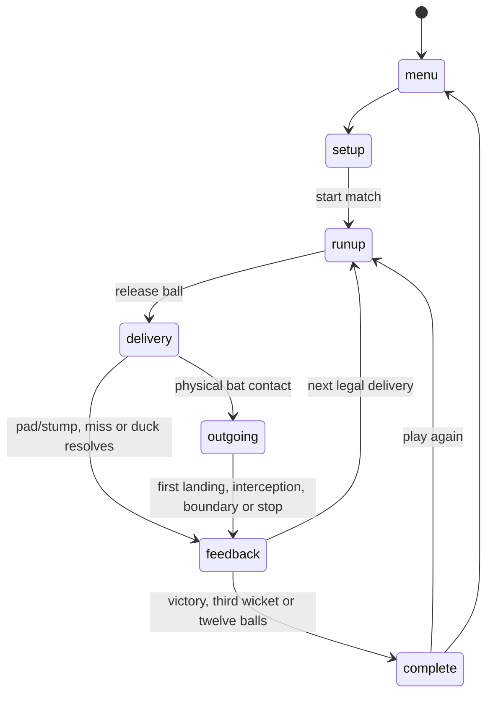

# Fun Cricket: architecture and mechanics

The design authority is [`instructions.md`](../instructions.md). This document describes the implementation and its intentional arcade simplifications.

## Ownership and module boundaries

`src/core/game.ts` contains `CricketGame`, the sole simulation owner. It owns the current match, committed delivery, ball, committed shot, lifecycle phase, simulation clocks, and delivery-resolution guard. `src/core/types.ts` defines their shared contracts. The immutable reducer in `src/match/match.ts` applies a resolved delivery exactly once at the controller boundary; the reducer also refuses to advance a completed match.

| Module | Responsibility |
|---|---|
| `core/config.ts` | Central match, timing, confidence, delivery, field, physics, and camera settings |
| `core/math.ts` | Vector helpers and seeded pseudorandom generator |
| `input/input.ts` | Retained eight-direction selection, opposing-axis handling, shot repeat suppression and locking |
| `bowling/bowling.ts` | Pre-delivery strategy, legal trajectory generation, virtual field selection |
| `physics/ball.ts` | Shared live/predictive flight, bounce, turn and rolling integration |
| `physics/collision.ts` | Moving pad capsules and swept wicket-envelope collision |
| `batting/batting.ts` | Shot-family assistance, timing, compatibility, swept blade contact and outgoing velocity |
| `animation/pose.ts` | Original authored bat/body motion, limb joint solving and matching pad geometry |
| `confidence/confidence.ts` | Personal rolling history, confidence calculation and bounded quality/power/precision modifiers |
| `fielding/fielding.ts` | Catching-zone eligibility, first landing, continuous interception and geometric runs |
| `match/match.ts` | Batting roster, totals, personal records, replacement, strike changes and terminal results |
| `rendering/scene.ts`, `rendering/player.ts` | Three.js scene, fixed camera and articulated original characters |
| `ui/ui.ts` | Menus, live scoreboard, confidence, feedback, off-screen tracker and results |
| `audio/audio.ts` | Original synthesized contact, bounce, wicket and UI sounds |

The HUD reads simulation state. It does not generate runs, wickets, confidence, or a separate ball path. Rendering frequency does not determine simulation progress.

## World coordinates and clock

Distances use meters and simulation time uses seconds. Y is up; +Z points from the striker toward the bowler. The camera stands at -Z and looks toward +Z, so **-X is the right-handed batter's off side** and +X is the leg side. The striker is the scoring origin. A standard off-break turns toward +X; a standard leg-break turns toward -X. The tracker projects the same world X/Z positions.

`CONFIG.step = 1 / 120` sets a fixed 120 Hz simulation. The controller accumulates elapsed time and processes whole steps, preserving excess time instead of skipping collisions or scores. Before accepting a keyboard stroke between rendered frames, the application advances this same clock to the event timestamp; commitment then records simulation time. This avoids render-frame timing drift. Pause stops simulation progress; the application clears held keys on focus loss and resets accumulated time when pausing/resuming.

The renderer samples the same simulation clock for characters and ball. `CONFIG.camera` sets the single fixed camera. Neither a boundary nor a wicket changes its position or orientation.

## Lifecycle and one delivery

The implementation combines the specification's finer presentation transitions into these explicit phases:



Shot commitment is data within `delivery`, so the approaching ball continues moving during preparation and swing. A committed shot cannot be redirected or replaced. No-input balls continue naturally and resolve as a physical dismissal or a legal dot; the game never waits indefinitely for a key.

Before `runup`, the controller captures the current striker's confidence, generates the delivery and field, and clears the previous shot/outcome. The bowler releases at the end of the configured run-up. After physical resolution, the controller's guard permits a single outcome update. Wicket celebrations, milestone gestures and over changes occur during short feedback. Space only shortens already resolved presentation. Terminal conditions prevent another delivery from being prepared.

## Seeded randomness and fair bowling

`RNG` in `core/math.ts` is a Mulberry32-style integer PRNG. Match setup derives the pace and spin archetypes from the match seed. The gameplay stream uses the seed XOR `0xA3C59AC3`. Delivery choices, variation parameters, imperfect-contact deviation, and eligible catch draws consume that gameplay stream. Cosmetic audio noise uses a separate non-gameplay source and cannot change a match result.

Identical seed, configuration, input direction/type, and simulation-time commitments reproduce the same gameplay. The seed and `inputLog` are available for developer diagnostics; there is no player-facing replay camera or replay mode.

Bowling reads only completed outcomes and the pre-delivery match state. Normal/tactical/surprise selection starts at 80/15/5 for Beginner, 60/30/10 for Club, and 45/40/15 for Pro. Tactical signals start at 70% recent patterns, 20% match pressure, and 10% striker confidence. Examples include slower balls against repeated early swings and legal off-side yorkers against repeated leg-side lofts.

Every delivery freezes its release position, initial velocity, variation, movement, bounce prediction, expected contact, and virtual field before run-up. Nested vectors and field entries are frozen as well. Current uncommitted arrow inputs cannot alter bowling or move a fielder.

## Delivery physics and marker

`stepBall` integrates gravity and linear air resistance analytically within each step. Incoming swing is a lateral acceleration before the first pitch contact. A ground intersection is solved within the step; the ball is advanced to the actual impact point, vertical velocity reflects with configured restitution, horizontal velocity loses a configured fraction, and spin/seam turn applies as a lateral velocity change. Remaining time in that step continues from the bounce.

The generator solves initial velocity for a legal line and selected length. `predictDelivery` advances an independent ball using the same `stepBall` function and fixed interval as live play. It records the bounce and interpolates arrival at the configured contact plane. The late pitch ring uses that predicted bounce. It fades toward pitching and never reveals post-bounce turn or a struck ball's future landing.

Outgoing balls use the same gravity and drag. Ground contact dissipates bounce energy; sufficiently small hops settle into rolling. Rolling applies configured friction until finite stopping. Ball position is always a simulated world position; the game does not choose runs independently and then animate a suitable flight.

## Batting, timing and actual contact

Arrow taps retain a direction until changed. Compatible held arrows form diagonals. Opposing arrows cancel their shared axis; if no axis remains, the last valid direction stays selected. The first accepted A/S/D press locks the delivery's shot. Repeated keydown events cannot trigger another swing.

`selectStroke` uses shot intent, delivery length, contact height, and direction to choose defense, duck, drive, cut, pull, back-foot punch, late cut, or lofted drive. The authored motion supplies front/back-foot weight transfer, body rotation, hand positioning, preparation, follow-through and recovery. Assistance selects a movement; it does not ensure contact or safe placement.

For a selected family:

```text
ideal input time = expected ball arrival - animation lead time
timing error = committed input time + lead time - expected arrival
```

The initial fixed thresholds are:

| Intent | Perfect | Good | Mistimed outer limit |
|---|---:|---:|---:|
| Defense | ±70 ms | ±140 ms | ±210 ms |
| Grounded | ±45 ms | ±95 ms | ±160 ms |
| Lofted | ±35 ms | ±75 ms | ±130 ms |

These thresholds do not vary with confidence, difficulty or score. Timing labels describe execution rather than run outcomes. Physical overlap remains necessary even when the nominal timing label is good.

`sampleBatPose` returns the blade heel, toe, and face orientation at a given animation time. Both the renderer and collision code consume this pose. `sweptBatContact` checks the ball sphere against the moving oriented blade through subdivisions of the simulation step, then refines the first overlap. It returns an actual ball-center position and offset along the blade; the outgoing ball starts there. The ball is never moved to a predicted target to manufacture a hit.

Unsuitable direction choices change the target alignment and shot quality. Reach is bounded; a horizontal cut/pull blade stays at a plausible grip height so a low yorker can pass beneath an unsuitable stroke. Incoming speed, bat speed, contact offset, shot class, raw quality and confidence determine outgoing speed, deviation and launch angle. A bounded contact-energy curve makes very weak contacts trickle rather than retaining full swing power. Grounded S strokes never become catchable. A D attempt is classified as a genuine aerial stroke only when its raw contact quality passes the implementation's aerial threshold; weak failed lofts follow ground rules. A can produce a small physical deflection or a timed duck rather than a power shot.

## Individual confidence

Confidence belongs to a batter, not the team. All batters begin at 50%. The latest three contributions are retained; missing slots are zero and the divisor is always three:

```text
confidence = clamp(50 + (slot1 + slot2 + slot3) / 3, 0, 100)
```

One +50 result produces approximately 66.7%; three +50 results produce 100%; three -50 misses produce 0%. Neutral deliveries remain at 50%. The ordinary contribution mapping interpolates execution between the specified quality anchors; actual contact offset and direction suitability can reduce it. Controlled defensive contact contributes +10, a successful timed duck contributes 0, and an unresolved complete miss contributes -50.

Confidence for the current ball is captured before run-up. Launch quality, precision, power and catch survival use that captured value. Only after the outcome is resolved does the faced batter receive the raw execution contribution and recompute their personal history. Confidence-modified quality never feeds back into this history.

Let `raw` be contact execution in [0,1] and `centered = (confidence - 50) / 50`. Effective quality applies a bounded adjustment proportional to `4 * raw * (1 - raw)`, so confidence most affects marginal contact. Relative power starts at `1 + centered * 0.08`; precision deviation starts at `1 - centered * 0.35`. Neither modifier expands timing windows or creates a bat-ball collision. Perfect raw execution remains possible at zero confidence, and a raw miss remains a miss at full confidence.

For an eligible aerial landing inside a catching zone:

```text
P(caught) = 1 - 0.002 * pre-delivery confidence
```

The probability is 100% at 0 confidence, 90% at 50, and 80% at 100. Only then is one seeded draw used. Overlapping catch circles do not trigger additional draws. A drop awards the ordinary first-landing score. No valid catch zone means no catch draw and no random wicket.

## Field geometry and scoring

The initial circular boundary is 65 m from the striker. Virtual fielders occupy fixed X/Z points in configured presets, initially with 3 m catch and 5 m ground-interception radii. They do not move during a delivery and are not rendered as ordinary fielders or public catching overlays.

### Aerial first landing

1. Resolve any earlier physical pad/stump/bat interaction.
2. Simulate an eligible aerial shot until its actual first ground contact.
3. A first landing strictly beyond the boundary scores six before checking catches.
4. A landing inside the boundary and inside any catch circle permits the catch draw.
5. A successful catch gives one wicket and zero runs; otherwise use the landing rings.

| First landing distance | Uncaught score |
|---|---:|
| Below 12 m | 0 |
| 12 m to below 25 m | 1 |
| 25 m to below 40 m | 2 |
| 40 m to below 55 m | 3 |
| 55 m through the boundary | 4 |
| Beyond the boundary | 6 |

Scoring ends at first landing; later rolling cannot change it. The interior four-run ring is an intentional arcade rule. A ball merely flying above a catching circle is not caught, and a six cannot be caught by an out-of-bounds zone.

### Ground trajectory

`groundEvent` compares continuous segment-circle entries against the actual boundary crossing. The first event along movement wins, independently of fielder-array order. At interception the ball visibly stops at that point. Interior interceptions and natural stops award 0/1/2/3 using the 12/25/40 m thresholds; only reaching the actual boundary scores four. A ground shot can never score six or be caught.

Ring intervals are lower-inclusive, upper-exclusive. An exact 12/25/40/55 m aerial landing enters the higher band. An aerial landing exactly at the boundary remains inside; strictly beyond is six. A ground ball reaching the boundary scores four. Circle edges include tangencies and positions already inside the zone. `CONFIG.fielding.epsilon`, initially `1e-7`, provides common equality tolerance. An exactly simultaneous ground interception and boundary event resolves as an interception.

## Pad, stumps and simplified LBW

`samplePadGeometry` builds shin capsules from the same authored hips, feet and solved knees used to place the visible pads. `sweepCapsule` interpolates ball and pad movement across the step, samples for overlap, and refines first contact. `sweepStumps` uses a swept sphere against the radius-expanded configured wicket envelope.

Bat, pad and stump candidates are compared by their normalized contact time within the step. The earliest blocker wins unless the bat reaches the ball first. A pad collision stops the delivery physically even when it does not satisfy LBW; that case resolves as a dot.

Simplified LBW requires actual pad contact before bat contact, pitching not outside the leg-side wicket corridor, impact within the wicket corridor, and the projected unimpeded ball subsequently hitting the wicket envelope. Projection uses the same live integrator. An unsuitable defensive direction or off-spin delivery alone never causes an automatic wicket. Bowled requires actual swept entry into the configured stump region.

This is not a complete implementation of the Laws of Cricket: there are no umpire judgments, full shot-offering rules, detailed pad material response, or individual stump-cylinder contacts. It is a transparent, deterministic physical approximation for the agreed arcade mode.

## Match updates and strike

The reducer captures the batter who faced the delivery before any replacement or swap. That batter receives runs, one ball faced, dismissal status, raw history and any new individual milestone. Team runs, balls and wickets update atomically. A caught/bowled/LBW outcome cannot also award shot runs.

Reaching the target wins immediately. Otherwise the third wicket or twelfth legal ball ends in defeat. Terminal results do not load a fifth batter or prepare a new delivery.

For a continuing innings, replace a dismissed striker first, then swap strike for odd runs, then swap at the over boundary. Therefore one or three runs on ball six produce two swaps and the same batter faces the next over. A wicket on ball six brings in the replacement and then performs the over swap. Each batter retains their own score and confidence while off strike; replacements start with an empty history and 50% confidence.

## Assets, configuration and limitations

The runtime builds original articulated geometry from `rendering/player.ts` and samples the original curves in `animation/pose.ts`. A portable GLB with baked clips is supplied in `public/assets`; its manifest and the export utility record how to rebuild it. Runtime simulation uses the source poses directly so exported clip sampling cannot introduce a second contact clock. Asset provenance is recorded in [`public/assets/LICENSES.md`](../public/assets/LICENSES.md).

Use `core/config.ts` for match invariants and major numerical tuning: timing and leads, targets, confidence cap, delivery speeds/lengths/movement, bounce response, friction, field positions/radii, marker timing and camera. Keep locked v0.1 behavior intact when tuning. Geometry dimensions and authored movement curves are also defined in their source modules.

The field is presently circular. Aerodynamics are simplified drag/swing/spin rather than a fluid or seam simulation. Catching is the specified first-landing geometric arcade model, and defensive batting is not a full biomechanical simulation. Character motion is original authored articulated animation with procedural adjustment, not motion capture. Browser input is resolved on the fixed simulation clock rather than a sub-millisecond hardware timeline. This document does not claim measured hardware performance or completed human playtesting; acceptance evidence is maintained separately.
